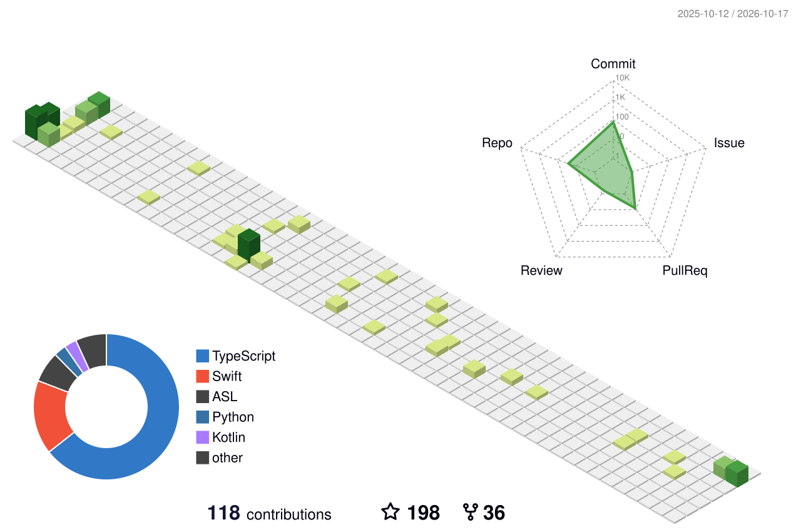

### 你好~ Hello~ 👋

✨我是一名前端开发攻城狮 小张 😄

✨I am a Web Developer，Amateur Web Designer who has just worked for one year, XiaoZhang 😄

✨欢迎来到我的GitHub主页

✨Welcome to my GitHub page
<!--
**7148505/7148505** is a ✨ _special_ ✨ repository because its `README.md` (this file) appears on your GitHub profile.

Here are some ideas to get you started:

- 🔭 I’m currently working on ...
- 🌱 I’m currently learning ...
- 👯 I’m looking to collaborate on ...
- 🤔 I’m looking for help with ...
- 💬 Ask me about ...
- 📫 How to reach me: ...
- 😄 Pronouns: ...
- ⚡ Fun fact: ...
-->

<!--START_SECTION:waka-->


**🐱 My GitHub Data** 

> 📦 250.8 kB Used in GitHub's Storage 
 > 
> 🏆 132 Contributions in the Year 2026
 > 
> 🚫 Not Opted to Hire
 > 
> 📜 88 Public Repositories 
 > 
> 🔑 6 Private Repositories 
 > 
**I'm an Early 🐤** 

```text
🌞 Morning                4393 commits        ███████████░░░░░░░░░░░░░░   42.67 % 
🌆 Daytime                5276 commits        █████████████░░░░░░░░░░░░   51.25 % 
🌃 Evening                626 commits         ██░░░░░░░░░░░░░░░░░░░░░░░   06.08 % 
🌙 Night                  0 commits           ░░░░░░░░░░░░░░░░░░░░░░░░░   00.00 % 
```
📅 **I'm Most Productive on Friday** 

```text
Monday                   1709 commits        ████░░░░░░░░░░░░░░░░░░░░░   16.60 % 
Tuesday                  1728 commits        ████░░░░░░░░░░░░░░░░░░░░░   16.78 % 
Wednesday                2214 commits        █████░░░░░░░░░░░░░░░░░░░░   21.51 % 
Thursday                 1884 commits        █████░░░░░░░░░░░░░░░░░░░░   18.30 % 
Friday                   2484 commits        ██████░░░░░░░░░░░░░░░░░░░   24.13 % 
Saturday                 70 commits          ░░░░░░░░░░░░░░░░░░░░░░░░░   00.68 % 
Sunday                   206 commits         ░░░░░░░░░░░░░░░░░░░░░░░░░   02.00 % 
```


📊 **This Week I Spent My Time On** 

```text
🕑︎ Time Zone: Asia/Shanghai

💬 Programming Languages: 
TypeScript               18 hrs 8 mins       ████████████░░░░░░░░░░░░░   46.64 % 
Markdown                 13 hrs 27 mins      █████████░░░░░░░░░░░░░░░░   34.60 % 
JSON                     1 hr 51 mins        █░░░░░░░░░░░░░░░░░░░░░░░░   04.77 % 
YAML                     1 hr 25 mins        █░░░░░░░░░░░░░░░░░░░░░░░░   03.66 % 
JavaScript               1 hr 5 mins         █░░░░░░░░░░░░░░░░░░░░░░░░   02.79 % 

🔥 Editors: 
VS Code                  19 hrs 50 mins      █████████████░░░░░░░░░░░░   51.00 % 
Codex Vscode             12 hrs 47 mins      ████████░░░░░░░░░░░░░░░░░   32.90 % 
Claude Code              6 hrs 15 mins       ████░░░░░░░░░░░░░░░░░░░░░   16.10 % 

🐱‍💻 Projects: 
grapes-demo              36 hrs 49 mins      ████████████████████████░   94.68 % 
gov                      59 mins             █░░░░░░░░░░░░░░░░░░░░░░░░   02.57 % 
obsidian-codex-users-zhan21 mins             ░░░░░░░░░░░░░░░░░░░░░░░░░   00.90 % 
travel-client-web-thin-2016 mins             ░░░░░░░░░░░░░░░░░░░░░░░░░   00.69 % 
CloudV-Board             10 mins             ░░░░░░░░░░░░░░░░░░░░░░░░░   00.46 % 

💻 Operating System: 
Mac                      38 hrs 53 mins      █████████████████████████   100.00 % 
```

🤖 **AI Coding This Week** 

```text
⏱ AI Coding Time: 37 hrs 38 mins (96.78%)

✍️ 23,965 lines written by AI, 67 lines written by hand (99.72% AI-written)

🔤 30,483,413 Input Tokens, 7,376,064 Output Tokens

💵 $128.38 Estimated AI Cost This Week

🧠 107 AI Sessions, 335 AI Prompts

GPT                      24,132 lines        ███████████████████████░░   91.88 % 
Opus                     1,977 lines         ██░░░░░░░░░░░░░░░░░░░░░░░   07.53 % 
Haiku                    146 lines           ░░░░░░░░░░░░░░░░░░░░░░░░░   00.56 % 
Qwen                     10 lines            ░░░░░░░░░░░░░░░░░░░░░░░░░   00.04 % 

🔎 AI Coding Insights:
🤖 AI-Driven — 99.72% of written lines came from AI
📚 Verbose Prompter — average 8,408 characters per prompt
🔁 Iterative Prompter — average 3 prompts per session
🚀 High AI Trust — 0.36% of changed lines were hand-edited
```

**I Mostly Code in JavaScript** 

```text
JavaScript               9 repos             ██████░░░░░░░░░░░░░░░░░░░   24.32 % 
Python                   3 repos             ██░░░░░░░░░░░░░░░░░░░░░░░   08.11 % 
Shell                    2 repos             █░░░░░░░░░░░░░░░░░░░░░░░░   05.41 % 
Kotlin                   2 repos             █░░░░░░░░░░░░░░░░░░░░░░░░   05.41 % 
ASL                      1 repo              █░░░░░░░░░░░░░░░░░░░░░░░░   02.70 % 
```


**Timeline**


 Last Updated on 29/10/2026 22:58:45 UTC
<!--END_SECTION:waka-->


[](https://github.com/anuraghazra/github-readme-stats)

[](https://github.com/anuraghazra/github-readme-stats)


